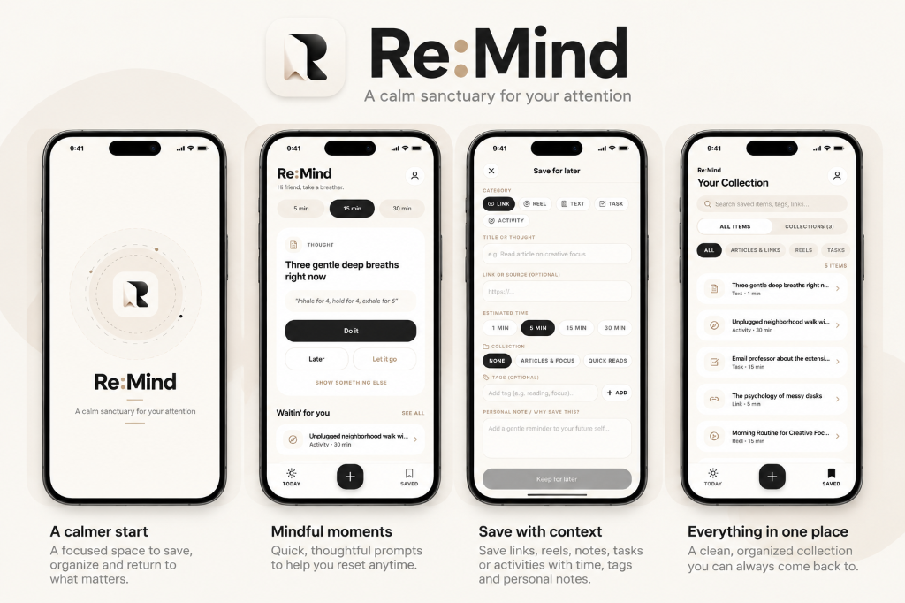

<div align="center">

  

  # Re:Mind

  **A calm sanctuary for your attention.**

  A mindful, offline-first "save for later" mobile application for iOS and Android.  
  Designed to gently resurface saved articles, reels, thoughts, and tasks during your free downtime—without guilt, algorithms, or streaks.

  <p>
    <a href="https://github.com/jaggureddy11/Mobile-App/releases"></a>
    <a href="https://expo.dev"></a>
    <a href="https://reactnative.dev"></a>
    <a href="https://www.sqlite.org"></a>
    <a href="LICENSE"></a>
    <a href="docs/PRIVACY.md"></a>
    
  </p>

  <p>
    <a href="https://expo.dev/artifacts/eas/F7JTjCk25ebkAKUweLo5LFPvbxJvoV-HS59zIuRUgqo.apk">
      
    </a>
  </p>

</div>

---

<p align="center">
  
</p>

---

## ✨ Why Re:Mind?

Most "read-it-later" apps become digital graveyards—infinite bookmark queues where saved links go to be forgotten under a mountain of backlog guilt. Social media feeds are engineered to steal your focus with endless autoplay and engagement loops.

**Re:Mind flips the paradigm:**

- ⏱️ **Time-Chunked Resurfacing**: Got 5 minutes between meetings? 15 minutes over coffee? 30 minutes before bed? Pick your downtime chip, and Re:Mind resurfaces exactly what fits your available window.
- 🧘 **24-Hour First-Day Rest**: Newly saved items rest for 24 hours before they are eligible to resurface. No more impulsive doomscrolling through items you saved 5 minutes ago.
- 🍃 **Guilt-Free "Let It Go"**: If an item no longer resonates, let it go with a single tap. No completionist pressure, no streaks, no overdue counters—backed by a gentle 5-second undo snackbar.
- 🔒 **Zero Telemetry, 100% Local**: No remote servers. No user tracking. No analytics. No account registration. All data lives privately in an on-device SQLite database with Write-Ahead Logging (`WAL`).

---

## 🚀 Key Features

| Feature | Description |
| :--- | :--- |
| **System Share Sheet Integration** | Save links, Instagram reels, YouTube videos, and text directly from any app using iOS & Android system share sheets (`expo-share-intent`). |
| **Smart Duration & Media Engine** | Automatically detects media type and suggests sensible reading/viewing durations (e.g. 1m for Reels, 15m for Deep Reads, 30m for Podcasts). |
| **Clean Metadata Extraction** | Strips out noisy platform boilerplate (`"Sneha on Instagram: ..."`, view counts, engagement stats) and automatically decodes HTML/Unicode entities. |
| **Offline-First SQLite Architecture** | Local-first relational schema with WAL mode, metadata caching, and sub-millisecond query latency across 5,000+ items. |
| **Gentle Downtime Notifications** | Configurable, non-intrusive reminder nudges with quiet hours enforcement and a custom soothing chime (`nudge.wav`). |
| **Warm Editorial Design** | Handcrafted cream color palette (`#FBF9F6`), custom typography scales, smooth micro-interactions, and accessible contrast ratios. |

---

## ⏱️ URL Classification & Duration Intelligence

When saving content (via the native Share Sheet or the in-app Add screen), Re:Mind classifies the link and assigns an estimated duration:

- **Reels & Short-Form Video** (`1 min`): Instagram Reels, TikTok, YouTube Shorts, Snapchat Spotlight.
- **Long-Form Video** (`15 min`): YouTube (`watch`, `youtu.be`), Vimeo, Twitch, TED Talks.
- **Podcasts & Audio** (`30 min`): Spotify episodes, Apple Podcasts, Pocket Casts, Overcast, SoundCloud.
- **Deep Reads & Essays** (`15 min`): Substack, The Atlantic, The New Yorker, Medium Longform, WSJ.
- **Quick Articles & Web** (`5 min`): Hacker News, Dev.to, Wikipedia, blogs, and general URLs.
- **Thoughts & Notes** (`1 min`): Quick ideas and personal reflections.
- **Tasks & Micro-Goals** (`15 min`): Focused todo items.
- **Mindful Activities** (`30 min`): Walks, breathing exercises, offline rituals.

---

## 🛠️ Tech Stack & Architecture

- **Framework**: [Expo SDK 58](https://docs.expo.dev/) (React Native 0.88 + React 19)
- **Routing**: [Expo Router v4](https://docs.expo.dev/router/introduction/) (File-based navigation with typed routes)
- **Storage**: [`expo-sqlite`](https://docs.expo.dev/versions/latest/sdk/sqlite/) with WAL Mode & automated schema migrations
- **State Management**: [Zustand](https://github.com/pmndrs/zustand) (Modular stores: `useItemsStore`, `useCollectionsStore`, `useSettingsStore`)
- **Native Share Sheet**: [`expo-share-intent`](https://github.com/achorein/expo-share-intent) (iOS App Group & Android Send Intent)
- **Notifications**: [`expo-notifications`](https://docs.expo.dev/versions/latest/sdk/notifications/) with custom sound channel
- **Icons**: [`lucide-react-native`](https://lucide.dev/guide/packages/lucide-react-native)
- **Animations**: [`react-native-reanimated`](https://docs.swmansion.com/react-native-reanimated/)

---

## 📱 Getting Started

### Prerequisites
- **Node.js**: `v20.x` or later (LTS recommended)
- **Package Manager**: `npm`
- **Expo CLI**: Bundled with Expo SDK 58 (`npx expo`)
- **EAS CLI**: `npx -y eas-cli@latest` (for cloud builds)
- **Xcode** (macOS) / **Android Studio** (for local native builds)

### 1. Clone & Install
```bash
git clone https://github.com/jaggureddy11/Mobile-App.git
cd Mobile-App
npm install
```

### 2. Run the Development Server
```bash
npx expo start
```

### 3. Build & Run Native Development Builds
Because Re:Mind utilizes custom native code (Share Intents, SQLite, custom notification audio), run a native development build:

```bash
# Run on iOS Simulator (macOS only)
npx expo run:ios

# Run on Android Emulator or connected physical device
npx expo run:android
```

> **Note on Native Folders**: The `ios/` and `android/` folders are generated via Expo Continuous Native Generation (CNG). Never modify them directly—all native configs are declared cleanly in `app.json`.

---

## 🧪 Testing & Quality Assurance

Re:Mind maintains 100% automated test coverage across domain logic, SQLite migrations, UI screens, and edge cases:

```bash
# Run complete Jest test suite (34 test suites, 434 tests)
npm test

# Run TypeScript typecheck
npx tsc --noEmit

# Run 5,000-item SQLite performance benchmark
npm run benchmark

# Run Expo Doctor dependency diagnostics
npx expo-doctor
```

---

## 📦 Building with EAS

```bash
# Preview build (Android standalone APK for internal testing)
npx eas-cli build --profile preview --platform android

# Production store build (AAB / IPA)
npx eas-cli build --profile production --platform all
```

---

## 📂 Repository Structure

```
├── app/                  # Expo Router screens & layouts (file-based routing)
│   ├── (tabs)/           # Primary tabs: Today, All Saved, Settings
│   ├── add.tsx           # Manual save modal with auto-scrolling keyboard avoidance
│   ├── item/[id].tsx     # Item detail & editing screen
│   ├── onboarding.tsx    # Warm 2-step onboarding flow
│   └── _layout.tsx       # Root layout & splash handler
├── src/
│   ├── components/       # Reusable UI primitives (ActivityCard, TimeChip, NavigationFooter)
│   ├── config/           # Feature flags and app configuration
│   ├── db/               # SQLite schema, migrations, repositories & WAL setup
│   ├── domain/           # Core domain: classification, resurfacing, eligibility, purge
│   ├── platform/         # Native integrations: share intent, notifications, scraper, sync
│   ├── theme/            # Design tokens: palette, typography, spacing, radii
│   └── utils/            # Haptics, perf tracker, privacy-safe debug logger
├── docs/                 # Engineering documentation & showcase media
│   ├── ARCHITECTURE.md   # System architecture and design decision resolutions
│   ├── AUDIT.md          # 12-point architecture & security audit log
│   ├── BENCHMARKS.md     # 5,000 item SQLite performance metrics
│   ├── PRIVACY.md        # Zero-telemetry & local-first privacy specifications
│   ├── RELEASE.md        # App Store & Play Store pre-submission answer sheets
│   ├── TESTING.md        # Test suite catalog & physical hardware testing matrix
│   └── assets/           # High-resolution logos & product showcase banners
├── scripts/              # Developer & benchmark automation scripts
├── assets/               # Production runtime icons, splash screens, and chime audio
├── LICENSE               # MIT License
├── README.md             # Project overview & documentation
├── app.json              # Expo application configuration & native plugins
└── eas.json              # EAS Build profiles
```

---

## 📚 Documentation

For in-depth guides and technical details:

- [**System Architecture & Decisions**](docs/ARCHITECTURE.md): Design tokens, precedence rules, and domain resolutions.
- [**Privacy & Security Guarantees**](docs/PRIVACY.md): Zero-telemetry, local SQLite encryption, and data ownership.
- [**Hardware Testing Matrix**](docs/TESTING.md): Comprehensive test catalog (434 automated tests) and physical QA checklist.
- [**Release & Store Submission Guide**](docs/RELEASE.md): App Store Connect and Google Play pre-submission answer sheets.
- [**Performance Benchmarks**](docs/BENCHMARKS.md): Cold start, search, and resurfacing latency with 5,000 SQLite items.
- [**Architecture Audit**](docs/AUDIT.md): Comprehensive 12-point architecture, security, and schema review.

---

## 📄 License

This project is open source and available under the [MIT License](LICENSE).  
Copyright (c) 2026 **Jaggu Reddy** ([@jaggureddy11](https://github.com/jaggureddy11)).
