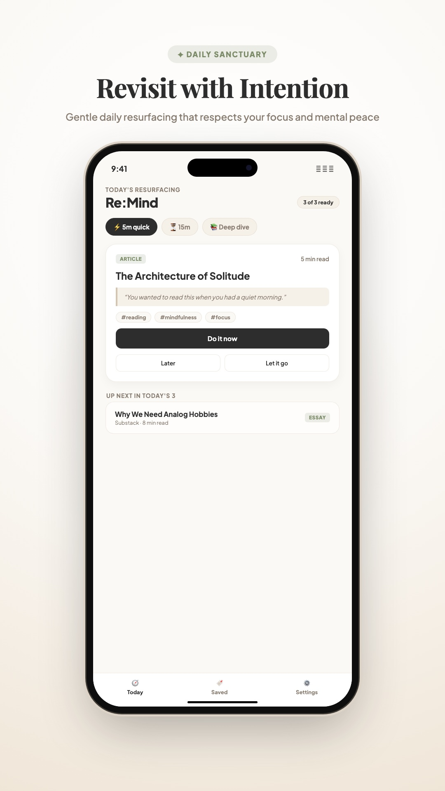
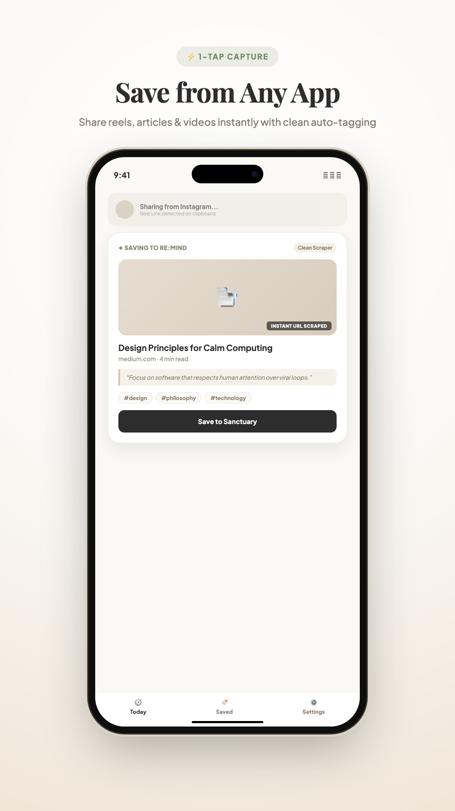
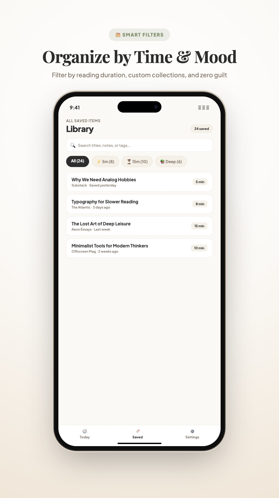
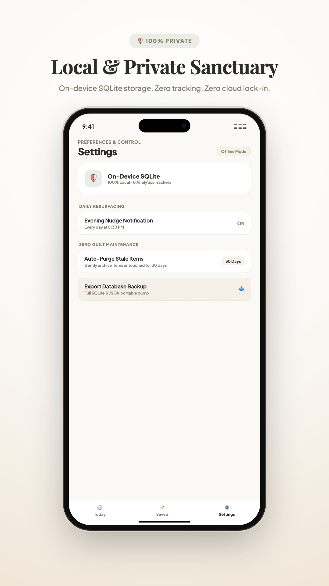

# Re:Mind (Mobile App)

> A calm, intentional "save for later" mobile application for iOS and Android. Offline-first, zero-telemetry, and designed to gently resurface saved articles, reels, thoughts, and tasks during your free downtime.

<p align="center">
  
  
  
  
</p>

---

## Key Principles & Architecture

- **Offline-First**: All data is stored in a local SQLite database (`maybe_later.db`) with Write-Ahead Logging (`WAL`) enabled.
- **Zero Telemetry**: No tracking, no analytics, no third-party crash reporting. All debug logs are in-memory (capped at 50, zero URLs/titles) and stay strictly on your device.
- **Smart Downtime Resurfacing**: Items are matched against your available downtime (5, 15, or 30 minutes) using a calm least-surfaced priority algorithm.
- **First-Day Rest**: Newly saved items rest for 24 hours before resurfacing to prevent cognitive overload.
- **System Share Intent**: Deep native integration allows saving directly from iOS and Android Share Sheets.

---

## URL Classification & Duration Rules

Re:Mind uses an intelligent URL classification engine in `src/domain/classification.ts` when saving items (both in the manual Add screen and via native system Share Intents). As an **intentional change from the original defaults** (where all saved links previously defaulted to 5m):

- **Reels & Short-Form Video**: **1 minute** (`type: reel`, `minutes: 1`)
  - Instagram Reels, TikTok, YouTube Shorts, Snapchat Spotlight.
- **Long-Form Video**: **15 minutes** (`type: link`, `minutes: 15`)
  - YouTube videos (`youtube.com/watch`, `youtu.be`), Vimeo, Twitch, TED Talks.
- **Podcasts & Audio**: **30 minutes** (`type: link`, `minutes: 30`)
  - Spotify podcast episodes, Apple Podcasts, Pocket Casts, Overcast, SoundCloud.
- **Deep Reads & Long Articles**: **15 minutes** (`type: link`, `minutes: 15`)
  - Substack, The New York Times, The Atlantic, The New Yorker, The Economist, WSJ.
- **Short Articles & General Web**: **5 minutes** (`type: link`, `minutes: 5`)
  - Medium, Hacker News, Dev.to, Hashnode, Wikipedia, and unknown/unclassified links.
- **Plain Text / Thoughts**: **1 minute** (`type: text`, `minutes: 1`)
- **Tasks**: **15 minutes** (`type: task`, `minutes: 15`)
- **Activities**: **30 minutes** (`type: activity`, `minutes: 30`)

When metadata scraping is unavailable, times out, or fails, the real save path safely falls back to these rules.

---

## Prerequisites

- **Node.js**: `v20.x` or later (LTS recommended)
- **Package Manager**: `npm`
- **Expo CLI**: bundled with Expo SDK 58 (`npx expo`)
- **EAS CLI**: `npx -y eas-cli@latest` (for cloud and local builds)
- **Xcode** (macOS) / **Android Studio** (for local native development builds)

---

## 1. Installation

Clone the repository and install dependencies:

```bash
git clone https://github.com/jaggureddy11/Mobile-App.git
cd Mobile-App
npm install
```

To install or upgrade Expo modules, always use Expo's dependency resolver:

```bash
npx expo install <package-name>
```

---

## 2. Running Locally

### Development Server

Start the Metro bundler:

```bash
npx expo start
```

### Running on Simulators / Devices

Because Re:Mind utilizes custom native code (`expo-share-intent`, `expo-sqlite`, `expo-notifications`), it requires a **Development Build** rather than bare Expo Go:

```bash
# Run on iOS Simulator (macOS only)
npx expo run:ios

# Run on Android Emulator or connected device
npx expo run:android
```

> **Note on Native Directories**: Native iOS and Android projects are generated on-the-fly via Expo Prebuild (Continuous Native Generation). Do not manually edit files in `ios/` or `android/`. All native configurations are maintained in `app.json`.

---

## 3. Testing & Code Quality

Run tests, typechecks, and diagnostic audits before committing:

```bash
# Run complete Jest test suite (230+ unit & integration tests)
npm test

# Run TypeScript compiler check
npx tsc --noEmit

# Run Expo Doctor dependency & configuration diagnostics
npx expo-doctor

# Run ESLint
npx expo lint
```

---

## 4. Building with EAS

Re:Mind uses Expo Application Services (EAS) for cloud and local builds.

### Login to Expo

```bash
npx eas-cli login
```

### Preview Builds (Internal Testing)

To generate standalone internal distribution builds for beta testers without publishing to app stores:

```bash
# Build Android APK / AAB
npx eas-cli build --profile preview --platform android

# Build iOS Ad-Hoc / Simulator build
npx eas-cli build --profile preview --platform ios
```

### Production Release Builds

```bash
npx eas-cli build --profile production --platform all
```

---

## Project Structure

```
├── app/                  # Expo Router screens & layouts (file-based routing)
│   ├── (tabs)/           # Main bottom tabs: Today, All Saved, Settings
│   ├── add.tsx           # Manual save modal
│   ├── item/[id].tsx     # Item detail screen
│   └── _layout.tsx       # Root navigator & splash screen handler
├── src/
│   ├── components/       # Reusable UI components (ActivityCard, TimeChip, etc.)
│   ├── config/           # Feature flags and app configuration
│   ├── db/               # SQLite database, schema migrations, and repositories
│   ├── domain/           # Core domain logic, eligibility, resurfacing, stores
│   ├── platform/         # Native integrations (share intents, notifications, metadata)
│   ├── theme/            # Design tokens (colors, typography, spacing, radii)
│   └── utils/            # Debug logger, performance tracker
├── docs/                 # Documentation, specifications, and showcase media
│   ├── ARCHITECTURE.md   # System architecture and design decision resolutions
│   ├── AUDIT.md          # Security & architecture audit history
│   ├── BENCHMARKS.md     # 5,000 item SQLite performance benchmarks
│   ├── PRIVACY.md        # Zero-telemetry & local-first privacy specifications
│   ├── RELEASE.md        # Release checklist & App Store / Play Store sheets
│   ├── TESTING.md        # Test suite catalog & physical hardware verification matrix
│   └── showcase/         # App store & release preview screenshots
├── scripts/              # Developer & benchmark automation scripts
├── assets/               # Production runtime icons, images, and notification sounds
├── app.json              # Expo application configuration & plugins
└── eas.json              # EAS Build profiles
```

---

## Documentation

- [**System Architecture & Decisions**](docs/ARCHITECTURE.md): Design tokens, precedence rules, and domain resolutions.
- [**Privacy & Security Guarantees**](docs/PRIVACY.md): Zero-telemetry, local SQLite encryption, and data ownership.
- [**Hardware Testing Matrix**](docs/TESTING.md): Test suite catalog (430+ automated tests) and physical device checklist.
- [**Release & Store Submission Guide**](docs/RELEASE.md): App Store Connect and Google Play pre-submission answer sheets.
- [**Performance Benchmarks**](docs/BENCHMARKS.md): Cold start, search, and resurfacing latency with 5,000 SQLite items.
- [**Architecture Audit**](docs/AUDIT.md): Comprehensive 12-point architecture, security, and schema review.

---

## License

This project is open source and available under the [MIT License](LICENSE).


